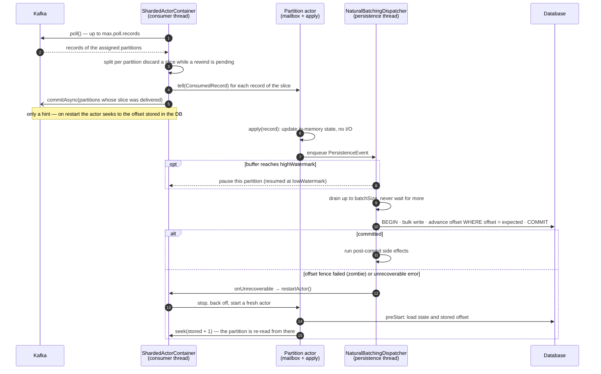

# 🦋 BufferFly


[](https://central.sonatype.com/artifact/io.github.cosmicsilence/bufferfly-core)
[](https://adoptium.net/temurin/releases/?version=25)
[](https://opensource.org/licenses/Apache-2.0)

BufferFly is a lightweight, virtual-thread-native **actor framework for Java 25+** that acts as an
**in-memory shock absorber and natural batching engine** in front of high-volume databases — most
commonly between a Kafka consumer and a relational store.

---

## Modules

| Module | What it is | Use it when |
| :--- | :--- | :--- |
| 📦 **bufferfly-core** | The virtual-thread actor engine: actors, mailboxes, the `VTDispatcher`, the persistence/batching runner, and the backpressure primitives. | Almost always. General-purpose, massively scalable, near-zero idle cost. |
| 🏎️ **bufferfly-cpu-bound** | A hardware-pinned, busy-spinning dispatcher (`SpinningActorDispatcher`) built on JCTools MPSC queues and thread affinity. | Only for a handful of ultra-high-frequency, sub-microsecond-latency actors. |
| ⚡ **bufferfly-spring-kafka** | Spring Boot auto-configuration that wires BufferFly actors to Kafka partitions via the `@ShardedActor` annotation: one actor per partition, DB-stored offsets, backpressure that pauses partitions, and actor restart with offset rewind. | You run on Spring + Kafka and want the shock absorber wired for you. |

---

## Quick start

Requires **Java 25+**. Pick the module you need:

**Gradle**

```groovy
dependencies {
    implementation 'io.github.cosmicsilence:bufferfly-core:1.2.0'

    // Spring Boot + Kafka integration (already includes bufferfly-core)
    implementation 'io.github.cosmicsilence:bufferfly-spring-kafka:1.2.0'
}
```

**Maven**

```xml
<dependency>
    <groupId>io.github.cosmicsilence</groupId>
    <artifactId>bufferfly-core</artifactId>
    <version>1.2.0</version>
</dependency>

<!-- Spring Boot + Kafka integration (already includes bufferfly-core) -->
<dependency>
    <groupId>io.github.cosmicsilence</groupId>
    <artifactId>bufferfly-spring-kafka</artifactId>
    <version>1.2.0</version>
</dependency>
```

A first actor with `bufferfly-core`:

```java
final class Counter extends AbstractActor<Integer> {
    private long total; // owned by this actor alone: no locks

    @Override public void receive(Integer amount) { total += amount; }
    @Override public String name() { return "counter"; }
    @Override public void onError(Integer amount, Exception e) { /* log it */ }
}

ActorManager manager = new ActorManager();
ActorReference<Integer> counter = manager.start(new Counter());
counter.tell(1); // enqueued; processed on the actor's own virtual thread
```

Next steps: a [persistent actor with natural batching](#persistence-model), or
[one actor per Kafka partition on Spring](#-bufferfly-spring-kafka).

---

## The problem: Kafka + mini-transactions + connection pools under pressure

A very common ingestion pipeline looks like this:

```
Kafka partition ──► consumer ──► for each record: BEGIN; INSERT; COMMIT ──► Postgres
```

Under a burst this design falls apart, and it fails in a way that is painful to debug:

- **One tiny transaction per message.** Each record pays the full cost of a round-trip, a
  transaction begin/commit, WAL flush, and index maintenance. At 50k msg/s that is 50k
  transactions/s — the database spends most of its time on transaction overhead, not on your data.
- **Connection-pool exhaustion.** To go faster you add consumer threads; each needs a pooled
  connection. The burst drains the pool, callers block waiting for a connection, latency spikes,
  health checks start failing, and the pool's queue backs up into the JVM heap.
- **No real backpressure.** Kafka keeps handing you records as fast as you can `poll()`. If the DB
  slows down, the work piles up *in your application* (unbounded queues, growing heap) until an
  `OutOfMemoryError` or a cascading timeout storm takes the service down.
- **All-or-nothing offset commits.** If you commit offsets before the data is durable you lose
  messages on a crash; if you commit after, a crash mid-batch replays and double-writes. Getting
  exactly-once against a database is subtle and easy to get wrong.

The database would happily absorb the same load as **a few large bulk inserts** instead of millions
of tiny transactions — it just needs something in front of it to **coalesce** the writes and to
**push back** when it is behind.

## The solution: an actor as a shock absorber

BufferFly puts a thin in-memory layer between the stream and the database:

```
Kafka ──► Actor (in-memory, single-threaded, CPU-bound) ──► PersistenceRunner ──► DB
              │  no I/O, no locks, no blocking                 │  natural batching
              │  one actor per partition → ordered             │  one bulk write per batch
```

- **The actor loop is pure and non-blocking.** It never touches the database. It transforms each
  message and hands the result to the persistence layer. One actor owns a partition, so per-key
  ordering is preserved without locks.
- **The persistence runner does natural batching.** It drains whatever has accumulated in the
  buffer, up to `batchSize` events, into a **single bulk transaction** — it never waits for more.
  While one batch is being written the next one accumulates, so under load batches are full
  (maximum DB efficiency) and under light load each event is written as soon as the previous batch
  commits. Millions of tiny transactions become thousands of fat ones.
- **The buffer is the shock absorber.** Bursts are absorbed in memory and smoothed into a steady
  write rate the database can sustain. The connection pool sees one borrower doing bulk writes, not
  a thundering herd.
- **Backpressure is first-class.** When the buffer fills past a high watermark, BufferFly pushes
  back — on Spring + Kafka it *pauses the partition* so the broker stops delivering until the buffer
  drains back below a low watermark.

### End to end on Spring + Kafka

One partition's path, from the poll to the durable offset:



### Persistence model

`AbstractPersistentActor<T, E>` splits the work cleanly:

```java
public final class LedgerActor extends AbstractPersistentActor<ConsumedRecord<AddToAccount>, LedgerChange> {

    @Override
    public PersistenceRunner.PersistenceEvent<LedgerChange> apply(ConsumedRecord<AddToAccount> record) {
        // pure, in-memory transform — runs on the single actor thread, no I/O
        long newBalance = balances.merge(record.value().accountNumber(), record.value().amount(), Long::sum);
        return PersistenceRunner.newEvent(new LedgerChange(...), new BalanceApplied(...)); // + optional side effect
    }

    @Override
    public PersistenceRunner.SideEffectProcessor process() {
        // runs AFTER the batch is durably committed — the place for post-commit projections/notifications
        return sideEffect -> { /* update a read model, emit an event, ... */ };
    }
}
```

`TransactionalOperations<E>` is where you implement the **bulk write** and classify failures:

- throw `TransientException` → the whole batch is retried with exponential back-off;
- throw `SingleItemException` → the runner isolates the batch item-by-item, persists the good ones,
  and calls `onPoisonPill` for the offender (dead-letter it);
- throw `UnrecoverableException` → the runner halts and invokes the `onUnrecoverable` hook (in the
  Spring module this restarts the actor and rewinds the offset).

---

## 🛑 Backpressure spec

Backpressure is a **first-class primitive**, not an afterthought. It is the mechanism that turns the
in-memory buffer from a liability (an unbounded queue that grows until `OutOfMemoryError`) into a
genuine shock absorber: when the database falls behind, BufferFly stops pulling work in rather than
piling it up. This section is the normative description of how it behaves.

### The contract

> **A full buffer must never drop data and must never grow without bound. When the persistence
> buffer saturates, BufferFly signals upstream to _wait_; when it drains, BufferFly signals upstream
> to _resume_. Every signal is edge-triggered and fires exactly once per transition.**

### Watermarks and hysteresis

Backpressure is governed by two watermarks on the persistence buffer depth:

| Watermark | Meaning |
| :--- | :--- |
| `highWatermark` | Buffer depth at which pressure is **engaged** (the *rising edge*). Must be `> lowWatermark`. |
| `lowWatermark`  | Buffer depth at which pressure is **released** (the *falling edge*). Must be `>= 0`. |

Two distinct watermarks (high **strictly greater than** low) create a **hysteresis dead-band**. A
single threshold would thrash — pausing and resuming on every event as the depth jittered around it.
With a dead-band the system engages at `high`, stays engaged while the depth falls through the band,
and only releases once it recedes all the way to `low`. One clean pause, one clean resume.

```
buffer depth
   ▲
   │        ╭─── engage (rising edge → onBackpressure) ───╮
high┤───────●────────────────────────────────────────────┼─────────
   │       ╱ \                                             │
   │      ╱   \        (dead-band: no new edge)            │
low ┤────●─────\──────────────────────────────────────────●──────── release
   │   ╱        \____                                     ╱ (falling edge → onReleasedPressure)
   └──┴───────────────────────────────────────────────────────────▶ time
```

### Edge-triggering: `BackpressurePersistenceDispatcher`

`BackpressurePersistenceDispatcher<E>` is a **decorator** over any `PersistenceDispatcher`. It owns
no buffer of its own; it watches the delegate's `size()` and fires a `BackpressureCallback` on each
transition:

- `onBackpressure()` — fired **once** when the depth first reaches `highWatermark`;
- `onReleasedPressure()` — fired **once** when the depth, having been under pressure, recedes to
  `lowWatermark`.

State is a single `AtomicBoolean` (`underPressure`) flipped with compare-and-set, so each edge fires
exactly once even under concurrent enqueues, and the callback is idempotent to re-evaluation.

### The falling-edge problem — and the periodic evaluator

There is a subtlety that the design must handle explicitly. Watermarks are evaluated on **enqueue**.
That is sufficient for the rising edge (the buffer can only grow *because* events are being
enqueued). But it is **not** sufficient for the falling edge:

> Once `highWatermark` engages backpressure, upstream is paused and **stops enqueuing**. With no
> further enqueues, nothing observes the buffer draining back below `lowWatermark` — so the release
> would never fire and the partition would stay paused **forever**.

BufferFly closes this gap with a **configurable periodic evaluator**. When constructed with a
positive `evaluateIntervalMs`, the dispatcher runs a single daemon-threaded
`ScheduledExecutorService` that re-evaluates the buffer depth on a fixed tick:

```java
new BackpressurePersistenceDispatcher<>(
        delegate,            // the NaturalBatchingDispatcher being monitored
        highWatermark,       // engage here
        lowWatermark,        // release here
        callback,            // pause/resume the partition
        evaluateIntervalMs); // 0 = enqueue-only (legacy); > 0 = also tick in the background
```

- The tick calls the same `evaluate(size)` the enqueue path uses. Because `evaluate` is guarded by
  the `AtomicBoolean`, a tick fires a callback **only on an actual edge crossing** — ticks in the
  dead-band or while idle are no-ops.
- The scheduler is **owned by the dispatcher** and shut down in `clear()` (invoked by
  `PersistenceRunner.stop()` when the actor stops), so it shares the actor's lifetime and leaks no
  threads.
- The interval is **caller-configurable** and is a latency/overhead trade-off: a smaller interval
  releases pressure sooner at the cost of more frequent wake-ups. Tests use a tiny window for
  deterministic transitions; **in production the user chooses the value**. Passing `0` disables the
  evaluator entirely (enqueue-only evaluation — only safe when upstream keeps enqueuing while the
  buffer drains).

### Wiring on Spring + Kafka: pause the partition, never drop the record

In `bufferfly-spring-kafka` the callback is wired to the Kafka partition through `KafkaContext`:

- `onBackpressure()` → `KafkaContext.pausePartition()` — fetching stops for **this partition only**,
  not the whole container, not other actors.
- `onReleasedPressure()` → `KafkaContext.resumePartition()` — fetching resumes once the buffer has
  drained to `lowWatermark` (fired by the periodic evaluator described above).

Two cooperating layers guarantee the contract:

1. **Proactive (buffer-driven).** The watermark crossings pause/resume the partition before the
   buffer can grow without bound. This is the primary path.
2. **Reactive (safety net).** If a record is delivered while already saturated and `tell` throws
   `UnderPressureException` or `MailBoxRefusedException`, the consumer pauses the partition and
   does not commit that partition's slice of the poll.

Because durability is anchored to the **DB-stored offset** (committed in the same transaction as the
data), a paused-and-redelivered record is simply re-consumed, never lost and never double-written.
**Under pressure the broker is told to wait; no message is ever dropped.**

### Invariants (what the tests pin down)

- Each edge (`onBackpressure` / `onReleasedPressure`) fires **exactly once** per transition.
- No release while the depth is in the dead-band (`low < depth < high`).
- The falling edge fires **from a scheduler tick** as the buffer drains, even with **zero** further
  enqueues (the whole reason the evaluator exists).
- `clear()` releases pressure if held and **shuts the scheduler down** — no further callbacks, no
  thread leak.
- End-to-end on embedded Kafka + HSQLDB: a flood pushes the buffer past `high` (pause engages), the
  buffer drains (resume fires), and **every** flooded record is persisted exactly once with the
  correct final balance.

> See `BackpressurePersistenceDispatcherTest` (core, the edge/hysteresis/scheduler unit spec) and
> `LedgerBackpressureTest` (spring-kafka, the end-to-end pause→resume→no-loss showcase).

---

## Why this design — the principles it stands on

BufferFly is not an arbitrary collection of tricks; every load-bearing decision is a direct
application of a well-established principle. This section defends the architecture by naming those
principles and linking to their canonical sources.

### The actor is a single-writer, and that is the whole point

An actor, in the [actor model](https://en.wikipedia.org/wiki/Actor_model), is a computational entity
that, in response to a message, makes local decisions and **modifies only its own private state** —
actors "can only affect each other indirectly through messaging (removing the need for lock-based
synchronization)." BufferFly's per-partition actor is exactly this: one actor owns a partition's
state, consumes messages from its mailbox, and never shares mutable state with another actor.

That maps one-to-one onto the
[**single-writer principle**](https://mechanical-sympathy.blogspot.com/2011/09/single-writer-principle.html)
as described in the [HFT engineering writeup](https://hftengineer.com/posts/single-writer-principle/):

> One thread mutates a piece of state. All other threads send messages to it via a queue. … It
> sidesteps the lock-free / memory-ordering / cache-contention swamp by construction.

The practical consequences the writeup lists are precisely the ones BufferFly relies on:

- **No cache-line bouncing / no memory-ordering overhead.** A single writer uses plain stores; there
  is no contended mutex and no CAS-retry loop on the hot path. (See also false sharing and cache
  lines in Martin Fowler's
  [Principles of Mechanical Sympathy](https://martinfowler.com/articles/mechanical-sympathy-principles.html).)
- **Partition to scale.** "When the writer *is* the bottleneck, you partition: one writer per symbol,
  one writer per shard, **one writer per partition key**." BufferFly runs **one actor per Kafka
  partition** — the same move, applied to ingestion.
- **Replay-determinism.** "A single writer with an ordered input stream is trivially deterministic."
  That is what makes a crashed actor safe to restart and replay from its last durable offset.

This is also why `bufferfly-cpu-bound` exists and why it is shaped the way it is: the LMAX Disruptor —
a ring buffer feeding a single writer — is the canonical realization of the principle, and the
spinning dispatcher is BufferFly's Disruptor-style variant for the few actors that need it.

### Natural batching is a named technique, not a heuristic

The `NaturalBatchingDispatcher` implements
[**natural batching**](https://martinfowler.com/articles/mechanical-sympathy-principles.html#NaturalBatching)
(Martin Thompson's "smart batching", since
[renamed](https://martinfowler.com/articles/mechanical-sympathy-principles.html#NaturalVs.SmartBatching)):

> The actor begins creating a batch as soon as requests are available in its queue, and completes the
> batch as soon as the maximum batch size is reached or the queue is empty.

Fowler's worked example shows why BufferFly drains *greedily up to `batchSize` or until the buffer
empties* rather than waiting for a fixed timeout — natural batching roughly **halves** the per-request
latency of a timeout strategy (best/worst `100/200 µs` vs. `200/400 µs`) while still coalescing writes
under load. Our `drainBatch()` is that algorithm verbatim.

### Backpressure is a first-class primitive because the alternative is collapse

Treating backpressure as the core mechanism (not an add-on) follows Thompson's
[**Apply Back Pressure When Overloaded**](https://mechanical-sympathy.blogspot.com/2012/05/apply-back-pressure-when-overloaded.html):
an overloaded system that keeps accepting work degrades catastrophically; one that signals upstream to
*wait* degrades gracefully. BufferFly's watermark/hysteresis machinery (see the
[Backpressure spec](#-backpressure-spec) above) is the implementation of that principle, and pausing
the Kafka partition is how the "wait" signal is delivered end-to-end.

### The offset is a fencing token — the only safe way to use a lease across a rebalance

A Kafka partition assignment is effectively a **lease**: after a rebalance a new consumer owns the
partition, but an old ("zombie") instance may still be alive — paused by GC, delayed on the network —
and about to write. Martin Kleppmann's
[**How to do distributed locking**](https://martin.kleppmann.com/2016/02/08/how-to-do-distributed-locking.html)
shows that a lease alone cannot make this safe, because a process can pause *at any point* and act on
an expired lease:

> The fix … is actually pretty simple: you need to include a **fencing token** with every write
> request to the storage service. … a number that increases every time a client acquires the lock …
> the storage server remembers that it has already processed a write with a higher token number, and
> so it rejects the request with [a lower one].

BufferFly's `consumer_offset.latest_offset`, advanced with a compare-and-set
(`WHERE latest_offset = :expected`) **in the same transaction as the data**, *is* that fencing token:
monotonic, checked by the "storage server" (the DB), and rejecting any write whose offset went
backwards. A failed CAS means a zombie is racing the new owner, so the batch is rejected as
`UnrecoverableException` and the actor restarts clean. This is exactly the discipline Kleppmann
prescribes — "enforce use of fencing tokens on all resource accesses under the lock" — rather than
trusting the lease (the Kafka assignment) on its own.

---

## Performance

There are two independent performance stories: **batching throughput to the database** and **raw
actor dispatch throughput**. The headline numbers follow; setup, methodology, time breakdowns and
caveats are in the [benchmarks README](bufferfly-benchmarks/README.md).

> ⚠️ The database benchmarks run Postgres and Kafka in Docker on the **same machine** as the test,
> so round-trips are near zero, and absolute figures vary with hardware and load. Treat gaps under
> ~20% as noise.

### 📊 Batching vs. one transaction per row

100,000 rows into Postgres: one persistent actor with natural batching vs 15 virtual threads each
doing one `INSERT` per row, through the same connection pool and SQL.

| Metric | Actor + natural batching | 15 virtual threads, one INSERT per row | Advantage |
| :--- | :---: | :---: | :---: |
| **time for 100,000 rows** | **~1,155 ms** | ~12,219 ms | **~10.6× faster** |
| **throughput** | **~86,500 rows/s** | ~8,180 rows/s | **~10.6×** |
| **pg `xact_commit`** | **476** (103 bulk tx) | 98,505 | **~207× fewer commits** |
| pg `wal_records` | 87,457 | 412,117 | ~4.7× fewer |
| **pg `wal_bytes`** | **8,484,851** | 33,862,017 | **~4.0× less WAL** |

- The 100,000 writes collapse into ~103 bulk transactions, so per-row commit and WAL-flush cost
  becomes a near-constant cost.
- The database is local here; over a network every commit also costs a round-trip, which this
  benchmark does not measure.

### 📊 Kafka → Postgres: actor vs. a classic locking consumer

150,000 messages on one topic with 3 partitions, keyed by account: 7 worker threads per partition
with one transaction per message, vs one actor per partition with natural batching.

| Metric | Classic (7 threads/partition, 1 tx/msg) | Actor (natural batching) | Advantage |
| :--- | :---: | :---: | :---: |
| **end-to-end time** | 98,050 ms | **3,453 ms** | **28.4× faster** |
| **throughput** | ~1,530 msg/s | **~43,440 msg/s** | **28.4×** |
| **pg `xact_commit`** | 149,269 | **512** | **≈292× fewer commits** |
| pg `wal_records` | 1,530,328 | 720,263 | ~2.1× fewer |
| **pg `wal_bytes`** | 106,938,138 | **54,968,827** | **~1.9× less WAL** |

- Same result (every message exactly once, identical balances), ~292× fewer commits.
- This shows the value of **batching**, not of the actor model: the next benchmark gives the
  conventional design batching too.

### 📊 Kafka → Postgres: actor vs. a batching locking consumer

The strongest conventional design: balances in memory under per-account locks (7 workers per
partition), one bulk transaction per 500-record poll, then `commitSync`. 600,000 messages per
scenario, medians of 5 rounds.

| Key distribution | Locking batch | Actor (batch 500) | Actor speed | Contended locks | Out-of-order rows |
| :--- | ---: | ---: | ---: | ---: | ---: |
| round-robin, 1,500 accounts | 15,870 ms | **14,790 ms** | **1.07×** | 0 | 0 |
| shuffled, 1,500 accounts | **13,078 ms** | 13,663 ms | 0.96× | 195 | 1,166 |
| shuffled, 30 accounts (hot keys) | **7,570 ms** | 9,167 ms | 0.83× | 7,982 | 53,596 |

- **Same database cost, so throughput is a tie on 1,500 accounts.** Both commit ~1,200 times and
  spend 75–93% of their time in the transaction. With 30 hot accounts the lock consumer won every
  round; why is not measured.
- **Ordering differs.** The lock consumer's workers apply an account's updates out of Kafka order
  (53,596 rows with hot keys); the actor never does.
- **What the actor adds is structural:** no locks, per-partition backpressure, and supervised
  restart with offset rewind.

### 📊 Kafka → Postgres: sharded actors vs. Apache Flink

Apache Flink 2.2.1 (`KafkaSource` → `keyBy(account)` → keyed `ValueState` → `JdbcSink`, batches of
500, checkpointing off) vs BufferFly's `ShardedActorContainer` with an actor per partition. Same
topic, tables and batch size; 600,000 messages, medians of 3 rounds, steady-state time:

| Key distribution | BufferFly (3 writers) | Flink, parallelism 3 | Flink, default (22) |
| :--- | ---: | ---: | ---: |
| round-robin, 1,500 accounts | 17,063 ms | 13,934 ms | **6,736 ms** |
| shuffled, 1,500 accounts | 12,574 ms | 13,875 ms | **6,107 ms** |
| shuffled, 30 accounts (hot keys) | 9,092 ms | 12,481 ms | **6,617 ms** |

- **With the same 3 writers**, BufferFly and Flink are close on 1,500 accounts, and BufferFly is
  ~1.4× faster with hot keys (the cause of Flink's slowdown is not measured).
- **Flink at default parallelism** writes over 22 connections against BufferFly's 3 and was fastest
  in every scenario.
- **BufferFly commits about half as often** and writes up to ~30% less WAL. Every run is exact,
  including the partition moves while the consumer group forms.

### Operational predictability: BufferFly vs. Flink in production

Raw throughput benchmarks only tell half the story; how each system behaves when scaled across
Kubernetes pods in front of a relational database is equally critical:

- **Hard cap on database writers.** In BufferFly, active writers are bounded by your **Kafka
  partition count** (1 actor and 1 writer per partition). Deploying 10 Spring Boot pods for a
  20-partition topic means **at most 20 concurrent database writers** for that topic across the
  whole cluster, giving the database a predictable, bounded load regardless of pod count. (During
  a rebalance, a revoked actor's in-flight batch can briefly overlap with the new owner; the offset
  fence rejects whichever write is stale.)
- **No separate sink tuning required.** In Flink, `keyBy` decouples downstream operators from Kafka
  partitions. Scaling out TaskManagers scales sink parallelism along with it, which can flood a
  relational database with concurrent connections and row locks unless you explicitly cap sink
  parallelism, size task slots, and tune connection pools per pod.
- **No external state infrastructure.** BufferFly runs as a standard Spring Boot service, with
  offsets stored in your database and in-memory state reloaded from it when an actor starts. There
  is no JobManager, TaskManager slots, RocksDB state backend, or S3 checkpoint storage to configure
  and operate.
- **Data-Oriented In-Memory State (Structure of Arrays):** Because BufferFly actors own private state and rehydrate directly from the database on rebalance, you can apply **Data-Oriented Design** and store millions of entities in cache-friendly **Structure of Arrays (SoA)** primitive layouts (`long[]`, off-heap `MemorySegment`) with zero GC pressure. Flink requires state to live in managed `ValueState`/`MapState` (boxed heap objects or serialized RocksDB bytes) so it can snapshot and redistribute key groups during checkpoints and rescaling.

### 📊 Firehose: actor dispatch throughput

A burst of 15,000,000 messages to a single actor (`DispatcherComparisonBenchmarkTest`):

| Upstream Producers | bufferfly-core<br>*(Virtual Threads)* | bufferfly-cpu-bound<br>*(Hardware-Pinned Core)* | Speedup |
| :--- | :---: | :---: | :---: |
| **1 producer**   | ~5.5M msg/s | **⚡ 14.9M msg/s** | **2.71×** |
| **10 producers** | ~3.3M msg/s | **⚡ 13.9M msg/s** | **4.17×** |
| **50 producers** | ~2.8M msg/s | **⚡ 11.0M msg/s** | **3.97×** |

### 📦 bufferfly-core — the virtual thread engine

- **Blueprint:** a `VTDispatcher` with a bounded `LinkedBlockingQueue` mailbox per actor, handing
  execution to the JVM's virtual-thread carrier pool. One single-consumer slot per actor guarantees
  the single-threaded-actor invariant.
- **Ceiling:** ~2.8M–5.5M msg/s (more producers, lower), bounded by virtual-thread continuation and
  stack-frame overhead.
- **Idle cost:** ~zero. Thousands of actors co-exist with no dedicated threads and no busy-spin.
- **Best for:** business state machines, webhook ingestion, and standard Kafka partition processing.

### 🏎️ bufferfly-cpu-bound — the hardware-pinned spinning engine

- **The 15M mark:** a core-pinned infinite busy-spin thread (`SpinningActorDispatcher`) over a
  JCTools MPSC `LOCK XADD` mailbox eliminates the CAS-retry cliff, reaching ~11M–15M msg/s.
- **Self-healing affinity:** an amortized bitwise-mask counter (`& 0xFFFF`) re-checks core placement
  once every 65,536 cycles; if the OS migrates the thread it snaps back to its original core with no
  heavy JNI overhead.
- **Best for:** financial order books, market tickers, sub-microsecond tail-latency SLAs.

### ⚠️ When NOT to use BufferFly (and when not to use the spinning engine)

**Do not reach for BufferFly when:**

- **You need per-message, synchronous, read-your-write durability** (e.g. "the HTTP response must
  return the committed row id"). Batching is asynchronous by nature; a request/response store is a
  better fit.
- **Your volume is low.** If the database comfortably handles one transaction per message, the
  batching layer is complexity you don't need.
- **You require cross-key/global transactional guarantees** spanning many partitions. BufferFly's
  ordering and offset guarantees are **per partition**.
- **Your workload is dominated by blocking I/O inside the actor.** Actors must stay CPU-bound and
  non-blocking; blocking in `receive`/`apply` defeats the model.

**Do not use `bufferfly-cpu-bound` (spinning dispatcher) unless:**

- you have a **small, fixed** number of ultra-hot actors and **isolated physical cores** to spare —
  each spinning actor pins one core at **100% CPU forever**, even while idle;
- you genuinely need sub-microsecond dispatch latency. For everything else the virtual-thread engine
  is cheaper and simpler. The spinning engine deliberately supports **only** the `THROW` backpressure
  strategy (never `CALLER_RUNS`), because running actor work on a producer thread would destroy its
  cache-resident latency profile.

---

## ⚡ bufferfly-spring-kafka

Spring Boot auto-configuration that turns a plain class into a sharded, persistent, backpressure-aware
Kafka consumer. You write the actor; BufferFly wires the consumer, the lifecycle, and the recovery.

### Setup

Add `bufferfly-spring-kafka` (see [Quick start](#quick-start)). Spring Boot's Kafka
auto-configuration provides the `ConsumerFactory` from your `spring.kafka.*` properties.

Annotate a factory bean with `@ShardedActor` and implement `ShardedActorFactory`:

```java
@Component
@ShardedActor(
        name          = "ledger",
        topic         = "ledger-events",
        concurrency   = 3,        // Kafka listener concurrency (consumers in the group)
        highWatermark = 50_000,   // engage backpressure at this buffer depth
        lowWatermark  = 20_000)   // release backpressure here (hysteresis)
public class LedgerShardFactory implements ShardedActorFactory<AddToAccount> {

    private final LedgerOperations operations;          // your TransactionalOperations
    private final BalanceConfirmationService readModel; // any collaborator

    @Override
    public Actor<ConsumedRecord<AddToAccount>> createActor(TopicPartition tp, KafkaContext ctx) {
        // one actor is created per assigned partition
        PersistenceConfig<LedgerChange> config = PersistenceConfig.builder(operations)
                .batchSize(200)
                .maxRetries(5)
                .onUnrecoverable(ctx::restartActor) // halt + restart + rewind on fatal failure
                .build();
        return new LedgerActor(actorName(tp), ctx, operations, config);
    }
}
```

That is all the wiring you write. BufferFly's `ShardedActorBeanPostProcessor` discovers the annotated
bean and stands up a `ConcurrentMessageListenerContainer` for you.

### How it works & the functionalities you get

**One actor per partition (rebalance-driven lifecycle).** On `onPartitionsAssigned` the framework
builds a `KafkaContext`, asks your factory for an actor, and starts it. On
`onPartitionsRevoked`/`onPartitionsLost` it stops that actor. Per-partition ordering is preserved and
a reassigned partition cleanly gets a fresh actor.

**Records are delivered as `ConsumedRecord<V>`** — the deserialized value plus its `topic`,
`partition`, and `offset` — so a persistent actor always has the offset available for the
fencing-token pattern below.

**No message loss (per-partition commits).** The listener is a batch listener — one invocation per
`poll()` — and commits offsets itself with a non-blocking `commitAsync` on the native consumer, only
for partitions whose whole slice of the poll reached their actor. Durability does **not** rely on the Kafka commit; it
relies on the actor storing the consumed **offset in the same database transaction as the data**. On
restart the actor seeks back to its DB-stored offset, so anything committed to Kafka but not to the DB
is simply re-consumed.

**Offset as an optimistic-locking fencing token.** The persistence layer stores the latest processed
offset (per topic/partition) and advances it with a compare-and-set (`WHERE latest_offset = :expected`)
in the same transaction as the data. If the CAS fails, a **zombie actor** (an old instance still
running after a rebalance) is racing the new owner → the batch is rejected as `UnrecoverableException`.

**Exactly-once sink.** Writes are idempotent by `(topic, partition, offset)` — a record that is
re-delivered after a restart/rewind is skipped rather than double-inserted, and the running balance is
only adjusted for newly-inserted rows. No loss, no duplicates.

**Backpressure that pauses the partition.** Through `KafkaContext` an actor's persistence layer can
`pausePartition()` when its buffer crosses the high watermark and `resumePartition()` once it recedes
to the low watermark — fetching stops for that partition only, not the whole container. As a reactive
safety net, if `tell` throws `UnderPressureException` or `MailBoxRefusedException` the consumer pauses
the partition and does not commit its slice. **No message is ever dropped under pressure — the broker
is simply told to wait.**

**Signal-based, thread-safe seeks.** Kafka's consumer is single-threaded, so an actor never touches it
directly. `KafkaContext.seek(...)`/`seekToBeginning()` record a *signal* that the framework applies on
the consumer thread (via Spring's `ConsumerSeekAware` callback). The rest of that partition's slice of
the current poll is discarded and not committed, while other partitions keep delivering and committing;
the next poll re-reads the partition from the sought position. The gate never compares offsets, so log
compaction removing the sought offset cannot wedge the partition.

**Persistence failure → actor restart → offset rewind.** When the runner hits an `UnrecoverableException`
(e.g. a failed zombie fence) it halts and calls your `onUnrecoverable` hook. Wiring it to
`ctx.restartActor()` stops the current actor and starts a fresh one, whose `preStart` rehydrates its
in-memory state and **seeks back to the last committed offset** — a clean, from-known-good restart with
no double counting and no loss.

**Poison pills → dead-letter + continue.** A record the database can never accept (e.g. a field too
long) surfaces as a real DB data-violation, which the operations layer classifies as
`SingleItemException`. The runner isolates the batch item-by-item: the good records before *and* after
the poison pill persist, and the offender is written to a dead-letter table. Nothing around it is lost.

**Post-commit side effects.** `PersistenceEvent`s can carry a `SideEffect` that the runner runs only
**after** the batch is durably committed — the right place to update a read model, warm a cache, or
emit a downstream event, with the guarantee it never runs ahead of the database.

See `bufferfly-spring-kafka/src/test/java/io/bufferfly/spring/ledger/` for a full, runnable showcase:
a sharded account **ledger** on embedded Kafka that keeps balances in memory, batches changes to
HSQLDB, stores the offset as a fencing token, dead-letters an oversized message, and restarts +
rewinds — all wired entirely by Spring through `@ShardedActor`.

---

## Building

```bash
./gradlew build          # compile + test all modules
./gradlew :bufferfly-core:test
./gradlew :bufferfly-spring-kafka:test
./gradlew :bufferfly-benchmarks:benchmarks   # needs Docker; see bufferfly-benchmarks/README.md
```

Requires a Java 25 toolchain.

## 📄 License

BufferFly is open-source software licensed under the [Apache License, Version 2.0](LICENSE).
